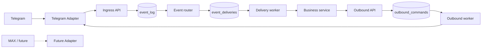

# Messaging Event Hub

**Независимое событийное ядро для мессенджеров и бизнес-сервисов.** Telegram — первый реально реализованный адаптер; MAX зарезервирован архитектурно и пока не реализован. PostgreSQL выполняет роль durable event store и очереди; Alembic управляет схемой БД. Код написан как самостоятельный проект.

> Версия 0.1 — инженерный MVP. Не заявляет exactly-once delivery или готовность к публичному SaaS без усиления безопасности и нагрузочных испытаний.

## Новый сервисный API v0.2 (аддитивный)

Для бизнес-сервисов добавлен **`POST /v1/messages`** с Bearer-токеном
сервиса, разрешением на конкретное подключение через
`POST /v1/publish-grants` и изоляцией ключей идемпотентности.
Новые сервисы могут быть только издателями без callback URL.
Контракт поддерживает текст, документы, фото, видео, аудио, голосовые сообщения,
анимации, inline-кнопки, редактирование текста и callback-ответы.
Формат `storage_ref` предусмотрен заранее, но пока требует отдельного S3-резолвера.

```http
POST /v1/messages
Authorization: Bearer <SERVICE_TOKEN>
Content-Type: application/json
```

```json
{
  "connection_key": "telegram-test",
  "idempotency_key": "i17-validation-98765",
  "target": {"conversation_id": "123456789"},
  "message": {"type": "text", "text": "Проверка завершена"}
}
```

Результат HTTP 202: `{"command_id":"UUID","created":true}` означает постановку
в очередь, не факт доставки. Токен сервиса хранится в переменной окружения
на стороне Event Hub и передаётся только в заголовке; в БД сохраняется
`publish_secret_ref: env://SERVICE_SECRET_NAME`.

**Обязательно прочитай [документацию контракта и безопасной миграции](docs/SERVICE_MESSAGES_API.md)
до обновления VPS**. Старые сообщения, Telegram webhook и Echo не затрагиваются.
`/v1/messages` не публиковать напрямую в интернет. Для будущего обработчика
на другом VPS потребуется отдельная защищённая сеть; размещение webhook остаётся
на голландском VPS.

## Стек

Python 3.12 · FastAPI · SQLAlchemy 2 (async) · asyncpg · PostgreSQL 16 · Alembic · HTTPX · Docker Compose.

**Для VPS с доменом `proxy.handyman.moscow` и Docker:** [пошаговое руководство по публикации через Caddy](docs/VPS_DEPLOY.md). Дополнительный файл `docker-compose.vps.yml` открывает наружу только HTTPS webhook, не административное API.

## Первый запуск

```bash
cp .env.example .env
# Отредактируйте POSTGRES_PASSWORD в .env и DATABASE_URL: пароль в URL должен совпасть.
# Установите ADMIN_API_KEY (минимум 20 символов).
# Для demo: CALLBACK_SHARED_KEY и соответствующий auth_secret_ref.
docker compose up --build -d
docker compose ps
curl http://127.0.0.1:8000/health/ready
```

Swagger UI: http://127.0.0.1:8000/docs — административные вызовы требуют `X-Admin-Key`. Порт API намеренно доступен лишь с localhost. Для публичных Telegram webhook нужен отдельный HTTPS reverse proxy с маршрутом к API, **но административные URL при этом необходимо закрыть на уровне proxy**.

### Создание связей

Сначала создаётся `workspace`, затем `connection`, `service` и `route`. Ответ каждого POST возвращает UUID. Ниже примеры для `http://127.0.0.1:8000` с заголовком `X-Admin-Key` (его можно задать в Swagger / curl). Ни один секрет не вставляется в JSON:

```json
POST /v1/workspaces
{"code":"sandbox","name":"Лаборатория"}
```

```json
POST /v1/connections
{
  "workspace_id":"WORKSPACE_UUID",
  "connection_key":"telegram-demo",
  "display_name":"Личный Telegram-бот",
  "provider_key":"telegram",
  "credential_ref":"env://TELEGRAM_BOT_TOKEN",
  "webhook_secret_ref":"env://TELEGRAM_WEBHOOK_SECRET"
}
```

Задайте секреты в `.env`; перезапустите API и worker. Секрет для webhook регистрируется в Telegram через `setWebhook` с параметром `secret_token`; URL: `https://YOUR_DOMAIN/v1/webhooks/telegram/CONNECTION_UUID`. **Не коммитьте токены; не публикуйте весь API без ограничения по путям.** Нужен публичный HTTPS endpoint: localhost без туннеля Telegram не достигнет.

Для теста без Telegram используйте `POST /v1/events`:
```json
{
  "connection_id":"CONNECTION_UUID",
  "event_type":"message.received",
  "idempotency_key":"manual-demo-001",
  "payload":{"conversation_id":"123","text":"Привет"}
}
```

Чтобы увидеть доставку в демонстрационный сервис:

```json
POST /v1/services
{
  "workspace_id":"WORKSPACE_UUID",
  "service_key":"audit-demo",
  "callback_url":"http://demo:8001/events",
  "auth_secret_ref":"env://CALLBACK_SHARED_KEY"
}
```

```json
POST /v1/routes
{
  "workspace_id":"WORKSPACE_UUID",
  "service_id":"SERVICE_UUID",
  "connection_id":null,
  "event_type":"message.received"
}
```

Повторите тестовое событие **с новым** `idempotency_key` (маршруты применяются в момент записи события). `docker compose logs -f demo worker` покажет обработку.

Исходящее сообщение:
```json
POST /v1/outbound
{
  "connection_id":"CONNECTION_UUID",
  "command_type":"message.send",
  "idempotency_key":"hello-001",
  "target":{"conversation_id":"TELEGRAM_CHAT_ID"},
  "payload":{"text":"Привет из Messaging Event Hub!"}
}
```

Для повторного запроса с тем же ключом API вернёт прежний ID, но не создаст новую команду. Результат запроса — **постановка в очередь**, не подтверждение доставки Telegram.

## Компоненты и поток данных



1. Telegram присылает webhook с секретным заголовком. Адаптер проверяет секрет и преобразует платформенный update в каноническое событие.
2. API в одной транзакции сохраняет событие и все сформированные для него доставки. Только после commit возвращается 200; если БД недоступна, HTTP 5xx и Telegram сможет повторить запрос.
3. Уникальный `(connection_id, idempotency_key)` блокирует повторную регистрацию одного update.
4. Delivery worker резервирует строки через PostgreSQL `FOR UPDATE SKIP LOCKED`, устанавливает lease, освобождает транзакцию и отправляет HTTP POST потребителю.
5. HTTP 2xx означает успешное подтверждение. Временная ошибка ведёт к retry с backoff; исчерпание попыток — `dead`. Потребитель должен сам дедуплицировать по `X-Delivery-Id`.
6. Бизнес-сервис создаёт `message.send` команду через отдельное API; worker передаёт её в Telegram-адаптер и фиксирует ответ.

Подробности, ограничения и ER-диаграмма: [docs/ARCHITECTURE.md](docs/ARCHITECTURE.md). Команды и сценарии: [docs/OPERATIONS.md](docs/OPERATIONS.md).

## Запуск тестов

```bash
pip install -e '.[test]'
pytest -q
```

## Миграции

```bash
docker compose run --rm migrate alembic current
docker compose run --rm migrate alembic upgrade head
```

В Compose service `migrate` автоматически выполняется раньше API и воркера. Не используйте `metadata.create_all()` при старте.

## Что сознательно не включено

MAX adapter, Mini App auth, очередь файлов / S3, RBAC, пользовательский кабинет, полноценные метрики, DLQ re-drive API и полноценная управляющая плоскость для клиентов. Их следует добавлять отдельными модулями, не модифицируя канонический контракт событий.
