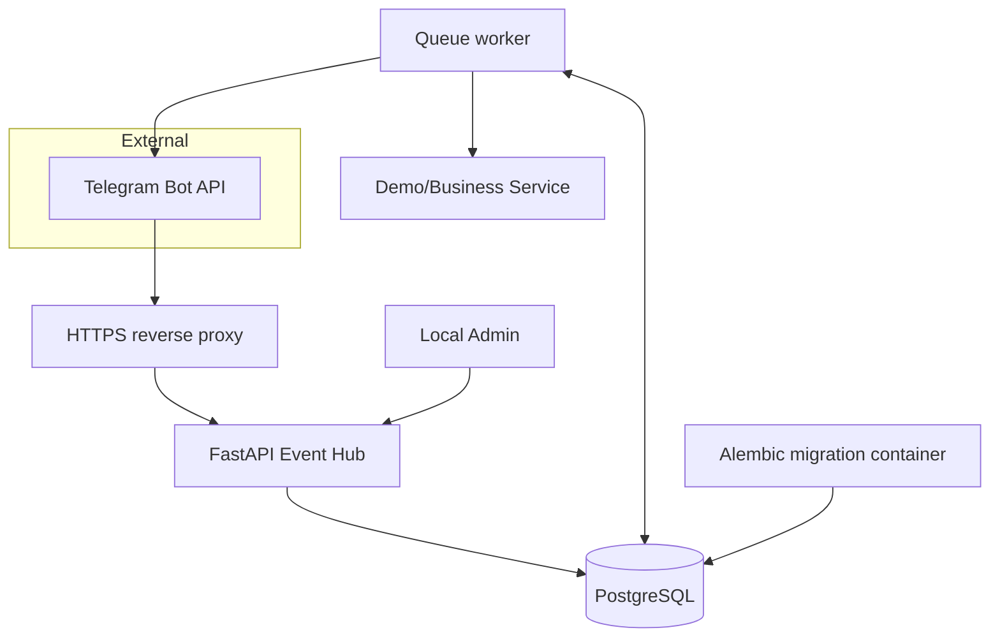
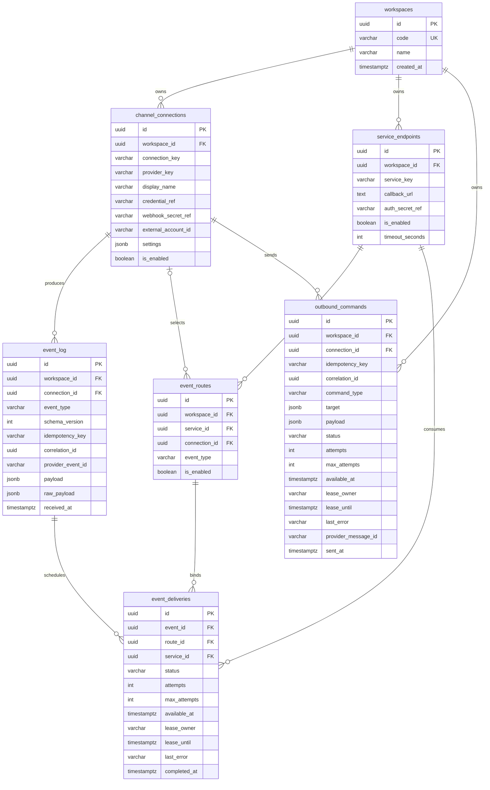
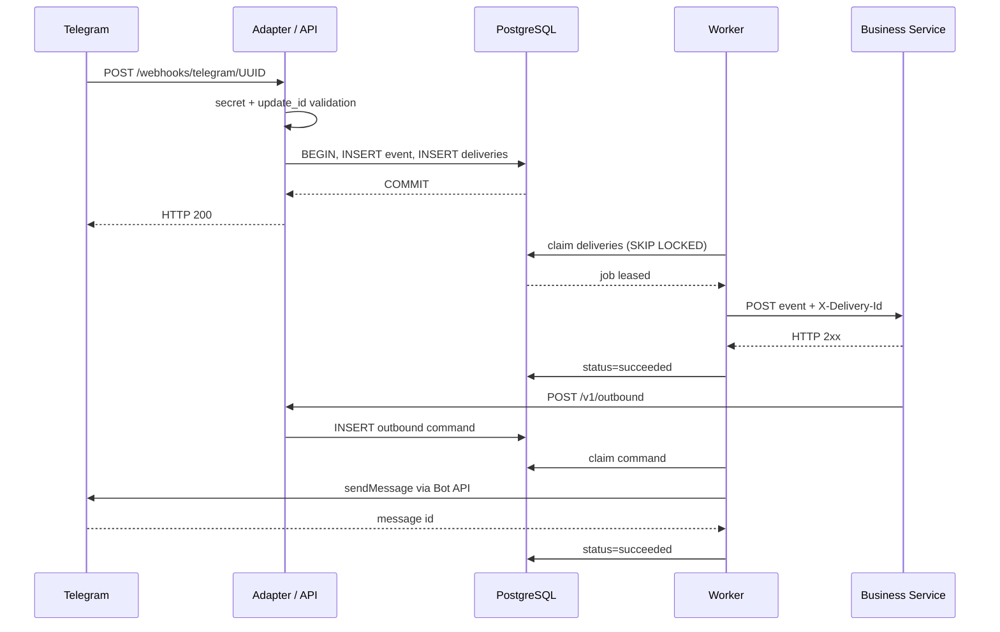

# Архитектура Messaging Event Hub (v0.1)

## v0.2: внешние сервисы и защищённая публикация

Входящий Telegram webhook остаётся на голландском VPS. Внутренний Event Hub API,
PostgreSQL и Worker также остаются там. Внешние бизнес-сервисы (позже обработчик
файлов на отдельном VPS со своим S3) смогут получать события через callback по
закрытой сети и публиковать команды через `POST /v1/messages` с сервисным
Bearer-токеном. Права определяет `relay.service_publish_grants`; идентификатор
отправителя фиксируется в `outbound_commands.source_service_id`. Детали и
миграция: [SERVICE_MESSAGES_API.md](SERVICE_MESSAGES_API.md).

## Границы компонентов

- **Core** управляет идентификацией подключений, регистрацией событий, маршрутизацией, очередями, повторами и журналом.
- **Channel adapter** отвечает за платформенный формат, проверку webhook, канонизацию и реализацию команд платформы.
- **Business service** получает единообразный HTTP event envelope; не импортирует Telegram/MAX SDK.
- **Mini App** впоследствии работает с собственным Business API; platform-specific init-data проходит проверку в отдельном auth adapter, не в Event Hub.
- **MAX** пока архитектурная точка расширения: регистрация connection не означает, что MAX адаптер действует.

## Развёртывание

Административные endpoints должны быть доступны только из защищённой сети. В docker-compose порт API проброшен на 127.0.0.1, публичного reverse proxy в комплекте нет.

## ER диаграмма

Таблицы находятся в схеме `relay`; Alembic revision `0001`. Основные FK заданы в SQLAlchemy. В API дополнительные tenant-проверки проверяют принадлежность выбранного service/connection одному workspace при создании маршрута.

## Схема последовательности

## Гарантии и риски

**At-least-once delivery**: если worker завершился между отправкой HTTP и фиксацией успеха, доставка повторится. Бизнес-сервис обязан дедуплицировать по `X-Delivery-Id` и сохранять его вместе с результатом одной транзакцией. Аналогично исходящая команда может быть доставлена в Telegram повторно при сбое между ответом Telegram и записью результата в БД; никакого exactly-once обещания нет.

**Лизинг**: worker берёт очередь через `SKIP LOCKED` и отбирает записи `pending/retry` либо `processing` с истёкшим lease. Lease 60 секунд, HTTP timeout меньше. Долгие callback-операции должны отвечать быстро, продолжая работу асинхронно.

**Секреты**: `env://NAME` — ссылки на конфигурацию среды. Нет общего секрета на все подключения, а незаданные ключи приводят к отказу. Сырой платформенный payload может содержать персональные данные, поэтому доступ к БД, сроки хранения и резервное копирование требуют отдельной политики.

**Доступность**: одна PostgreSQL инсталляция и один worker подходят для лабораторной нагрузки. Несколько воркеров допустимы благодаря блокировкам, но нагрузочные, аварийные и миграционные тесты обязательны.

**События**: тип `message.received` не зависит от Telegram; `telegram.update` фиксирует неизвестный тип платформенного update для дальнейшей обработки. Канонизация Telegram поддерживает обычные текстовые сообщения, документы/фото и callback. Остальные типы не преобразованы.

**Ограничения текущего MVP**: нет API просмотра очередей, административного re-drive, редактора правил, полноценного observability, безопасного ограничения callback destinations, secret rotation и управления правами клиентов. Не следует выставлять admin API в публичный интернет. Отсутствует MAX outbound.
