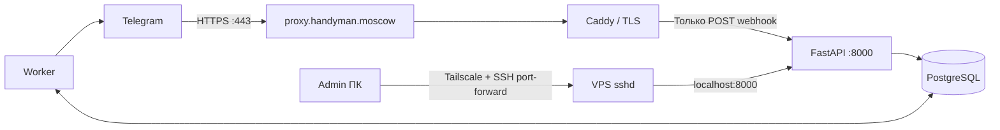

# Развёртывание на VPS: proxy.handyman.moscow

Документ для отдельного Linux VPS (Нидерланды) с уже установленными Docker и Tailscale. Дополнительные Nginx, Certbot, Cloudflare Tunnel и брокеры не требуются. HTTPS обеспечивает отдельный контейнер **Caddy**; конфигурация VPS включается только через дополнительный Docker Compose файл.

## 1. Сетевая модель



Публичные TCP-порты только 80 и 443 (помимо уже настроенного администрирования по SSH/Tailscale). API опубликован Docker Compose **только на 127.0.0.1:8000 VPS**, БД вообще не публикуется. В Caddy разрешён лишь `POST /v1/webhooks/telegram/*`. `GET /health/live`, `/docs`, `/v1/outbound` и `/v1/connections` снаружи получают 404.

## 2. Предварительные проверки на VPS

```bash
docker --version
docker compose version
cat /etc/os-release | head -n 5
sudo ss -ltnp | grep -E ':(80|443)\\b' || true
curl -4 -s https://api.ipify.org && echo
```

Последняя команда показывает внешний IPv4 адрес VPS (не публикуйте его в открытых сообщениях без необходимости). Если 80/443 уже заняты, не запускайте Caddy до разбора конфликта. Проверьте также облачный firewall/security groups и локальный firewall. Входящие TCP 80/443 должны быть разрешены; не отключайте защиту целиком и не включайте UFW без проверки доступа по SSH/Tailscale.

## 3. DNS в Cloud.ru

У регистратора NS уже заданы как `evo-cns01.cloud.ru` и `evo-cns02.cloud.ru`. **Не изменяйте NS.**

В DNS-зоне `handyman.moscow` добавьте A-запись:
- имя `proxy` (либо полное имя, если UI ожидает FQDN);
- тип `A`;
- значение = публичный IPv4 VPS;
- TTL 300 или системное значение.

Если A-запись `proxy` уже существует, обновите **её**, не создавайте дубликат. Проверить DNS:

```bash
dig +short proxy.handyman.moscow A
dig +short @evo-cns01.cloud.ru proxy.handyman.moscow A
```

Дождитесь, пока домен указывает на публичный адрес VPS. Если A/AAAA/CNAME конфликтуют, проверьте все записи `proxy`.

## 4. Загрузка проекта и секреты

Репозиторий приватный, поэтому клонирование требует авторизации GitHub (SSH-ключ или credential manager).

```bash
git clone git@github.com:glazole/messaging-event-hub.git
cd messaging-event-hub
cp .env.example .env
chmod 600 .env
nano .env
```

В `.env` укажите **разные** длинные случайные секреты для `POSTGRES_PASSWORD`, `ADMIN_API_KEY`, `TELEGRAM_WEBHOOK_SECRET`. Пароль PostgreSQL в `DATABASE_URL` должен совпадать с `POSTGRES_PASSWORD`; спецсимволы URL-кодируются. Для Telegram задайте `TELEGRAM_BOT_TOKEN`. Не помещайте токены в GitHub или чаты.

```bash
docker compose -f docker-compose.yml -f docker-compose.vps.yml config --quiet
docker compose -f docker-compose.yml -f docker-compose.vps.yml up -d --build
docker compose -f docker-compose.yml -f docker-compose.vps.yml ps
docker compose -f docker-compose.yml -f docker-compose.vps.yml logs --tail 100 caddy migrate api worker
```

API должен отвечать **локально на VPS**:
```bash
curl -fsS http://127.0.0.1:8000/health/ready
```

После успешного DNS + TLS внешний запрос к `https://proxy.handyman.moscow/` должен вернуть **404**, потому что корневой URL преднамеренно недоступен, но TLS-сертификат должен быть действителен.

```bash
curl -I https://proxy.handyman.moscow/
```

## 5. Безопасный доступ к Swagger/API из своего компьютера

Используйте существующий Tailscale + SSH, не публикуя админку. На **своём компьютере**:

```bash
ssh -L 8000:127.0.0.1:8000 glazole@TAILSCALE_VPS_IP
```

Откройте на компьютере `http://127.0.0.1:8000/docs` — туннель защищён SSH и Tailscale. Используйте HTTP заголовок `X-Admin-Key` из .env. Если локальный порт 8000 занят, замените первую 8000 на 18000 и откройте localhost:18000.

В API создайте workspace, Telegram connection, service и route по README. `credential_ref` = `env://TELEGRAM_BOT_TOKEN`, `webhook_secret_ref` = `env://TELEGRAM_WEBHOOK_SECRET`. Сохраните UUID connection.

## 6. Привязка Telegram webhook

После создания connection зарегистрируйте webhook через Telegram Bot API, указав:

```text
URL = https://proxy.handyman.moscow/v1/webhooks/telegram/CONNECTION_UUID
secret_token = TELEGRAM_WEBHOOK_SECRET
```

Метод: `setWebhook` (см. https://core.telegram.org/bots/api#setwebhook). Проводите регистрацию в защищённой консоли; не пишите Bot Token в логи GitHub Actions и общедоступные URLs. После этого сообщение в Telegram создаст строку `relay.event_log`, а для активных маршрутов — строки `relay.event_deliveries`.

## 7. Проверка состояния и эксплуатация

```bash
docker compose -f docker-compose.yml -f docker-compose.vps.yml logs -f --tail=100 api worker caddy
docker compose -f docker-compose.yml -f docker-compose.vps.yml exec postgres \
  psql -U eventhub -d eventhub -c "SELECT event_type, received_at FROM relay.event_log ORDER BY received_at DESC LIMIT 10"
```

Вместо eventhub укажите свои `POSTGRES_USER` и `POSTGRES_DB`. Если события есть, но ответов от бота нет, это ещё не означает неисправность ingress: нужен зарегистрированный service route и/или создание `outbound_command` бизнес-сервисом. В комплекте demo consumer принимает событие, но **не отправляет автоматический echo-ответ**.

Для обновления кода: `git pull`, затем снова `docker compose -f docker-compose.yml -f docker-compose.vps.yml up -d --build`. Для данных PostgreSQL предусмотрен Docker named volume; перед обновлениями схемы делайте резервные копии БД.

## 8. Что не следует делать

- Не публиковать `/docs`, `/v1/workspaces`, `/v1/connections` и `/v1/outbound` в интернет.
- Не открывать наружу порты PostgreSQL 5432 и API 8000.
- Не копировать production-токены из сторонних систем и рабочих проектов.
- Не считать результатом работы бота один лишь ответ `/health/ready`: нужен функциональный тест с Telegram.
- Не отключать TLS-проверку и не ставить `0.0.0.0:8000:8000` в основном Compose.
